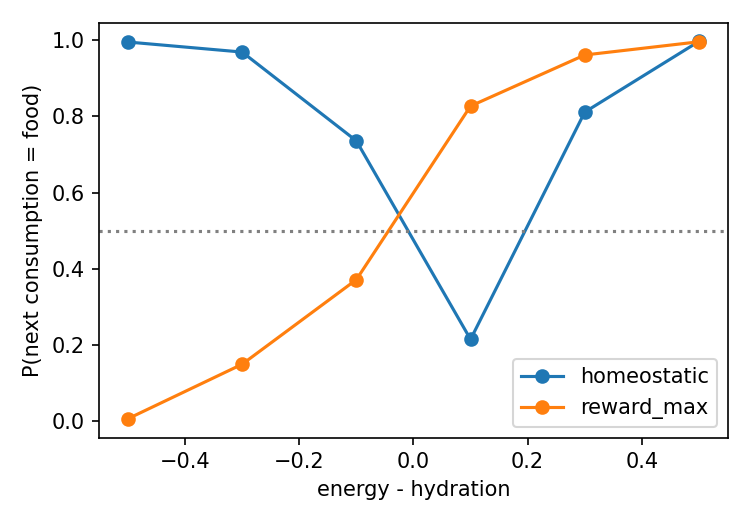
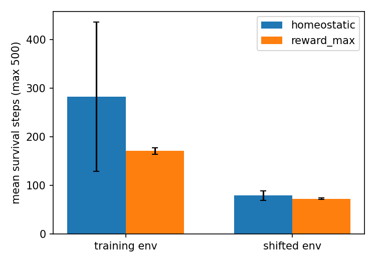
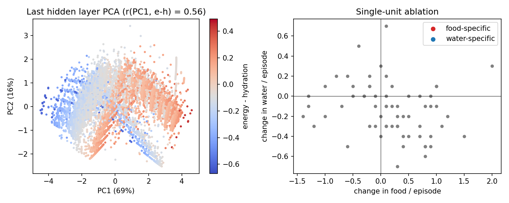

# Homeostatic vs reward-maximising PPO: a small exploratory study

**Question:** do agents driven by internal needs behave more animal-like, and adapt better, than agents that maximise a fixed reward?

**Setup**
- 8x8 grid, food and water in opposite corners, one toxic cell. Energy and hydration decay 0.004/step, +0.3 on eating/drinking; the episode ends when either hits 0 (max 500 steps).
- SB3 PPO, 3 seeds, 150k steps each, CPU. Homeostatic reward: 10 x (D(h_t) - D(h_t+1)), D = distance to h* = (0.8, 0.8) (Keramati & Gutkin 2014). Reward-max: +1 per consumption. Both get -1 on death.
- Test: training env, and a shifted env (random resource positions, decay doubled).

**Observed** (`results.json`, mean steps survived; random policy: 109 train, 73 shifted)
- Training env: homeostatic 282 (sd 154 across seeds), reward-max 171 (sd 6). One homeostatic seed hit the 500 cap; the other two matched reward-max.
- Shifted env: 79 vs 73, both near random. Neither generalised.
- Choice vs need: when energy is well below hydration, the homeostatic agent picks food almost always (P about 1.0). Reward-max picks food rarely there. The homeostatic curve is not clean at the high end.

With 3 seeds and one run, the training-env gap is mostly one seed. Read this as suggestive, not a result.

## Circuit analysis

`analyze_circuits.py` dissects the last hidden layer (64 units) of the homeostatic agent from seed 1 (the one that hit the 500-step cap; 150k steps, saved as `model_homeostatic.zip`), in the spirit of the lab's "modular circuit motifs dissected through ablation". PCA over 20 episodes: PC1 explains 69% of variance (PC2 16%) and correlates r = 0.56 with energy - hydration. Zeroing each unit over 10 episodes (baseline 12.5 food and 8.9 water per episode) cost at most 1.4 food or 0.7 water per episode, and **no drive-specific units were found**: no unit hurt one drive much more than the other, so the need signal looks distributed rather than modular. Effects are small and noisy at 10 episodes per unit. A seed-0 agent I tried first never drank at all, so it was uninformative.

**Next:** more seeds, a harder shift, multiple competing drives, hidden-unit ablation.

Refs: Keramati & Gutkin 2014, eLife; Yoshida, Sprekeler & Gutkin 2025, arXiv 2507.04998. Run: `python homeostatic_agent.py 150000`
